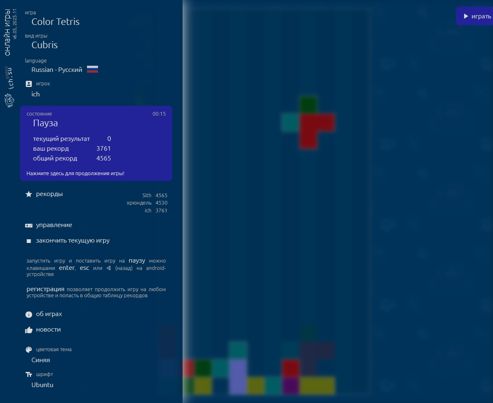
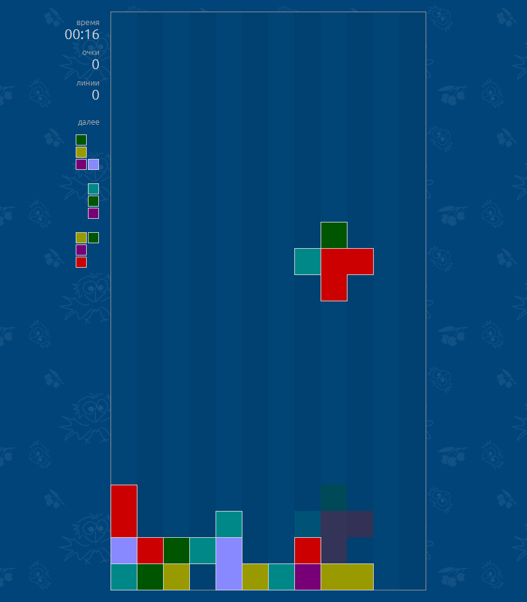
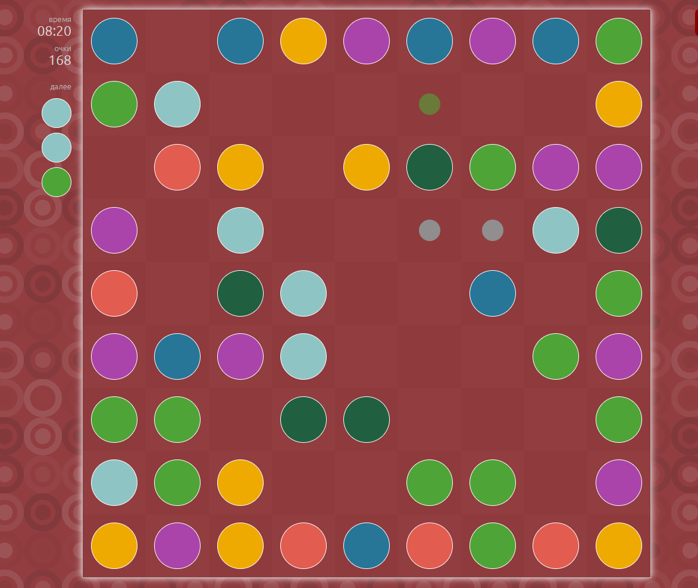
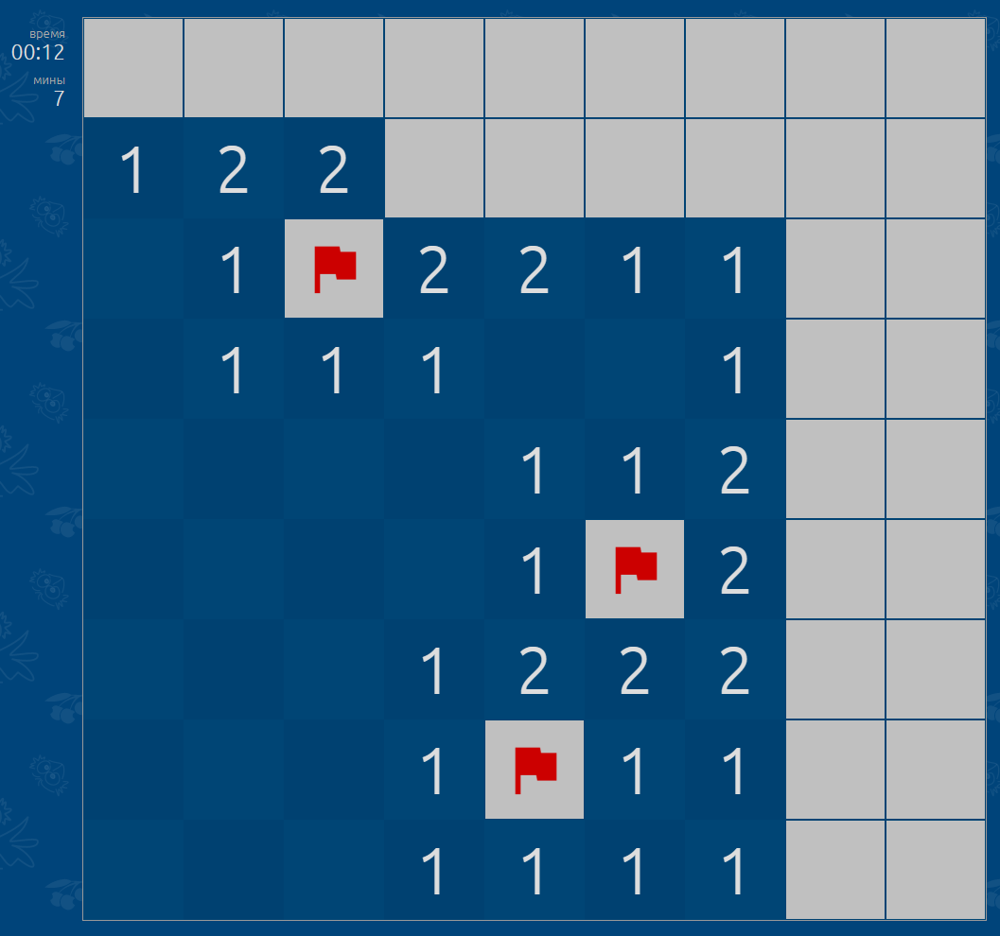
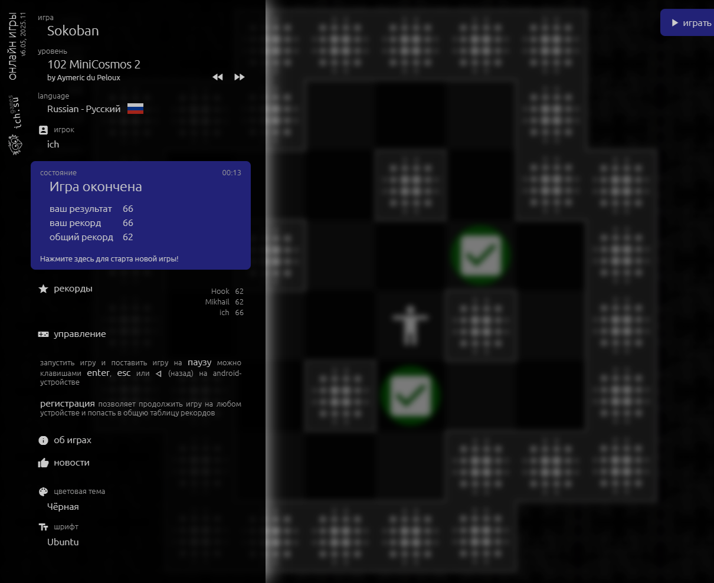
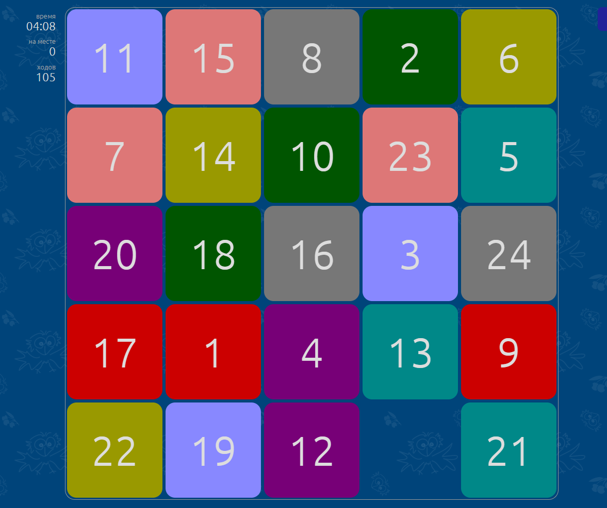

## Онлайн игры - Tetris, Color Tetris, Colris, Color Lines, Click, Sokoban, Сапёр, Пятнашки

* **Год написания:** 2019
* **Язык, БД:** PHP, JavaScript, jQuery, CSS3, MySQL

[**games.ich.su**](https://games.ich.su):

* 8 игр / более 40 видов игр.
* Можно играть в любом современном браузере на компьютере, планшете или смартфоне.
* Синхронизация со всеми Вашими устройствами. 
* Общая таблица рекордов. 
* Автоматическое сохранение игры. Можно продолжить любую начатую игру на любом Вашем устройстве.

### Онлайн игры • Lite

Онлайн игры • Lite – это упрощенные версии онлайн игр. В них нет регистрации, синхронизации между различными устройствами и общей таблицы рекордов.

[**games.ich.su/lite**](https://games.ich.su/lite):

* 6 игр / более 30 видов игр.
* Можно играть в любом современном браузере на компьютере, планшете или смартфоне.
* Во время игры не требуется постоянное подключение к Интернету.
* Lite версии являются Progressive Web App. Их можно установить на компьютеры, смартфоны и планшеты как приложения и играть даже при отсутствия Интернета.
* Автоматическое сохранение игры. Можно продолжить любую начатую игру.
* Локальная (только своя) таблица рекордов.

Скриншоты:

* 
* 
* 
* 
* 
* 

#

страница проекта на гитхабе:
[github.com/ich-su/games.ich.su](https://github.com/ich-su/games.ich.su)
[games.ich.su](https://games.ich.su)
